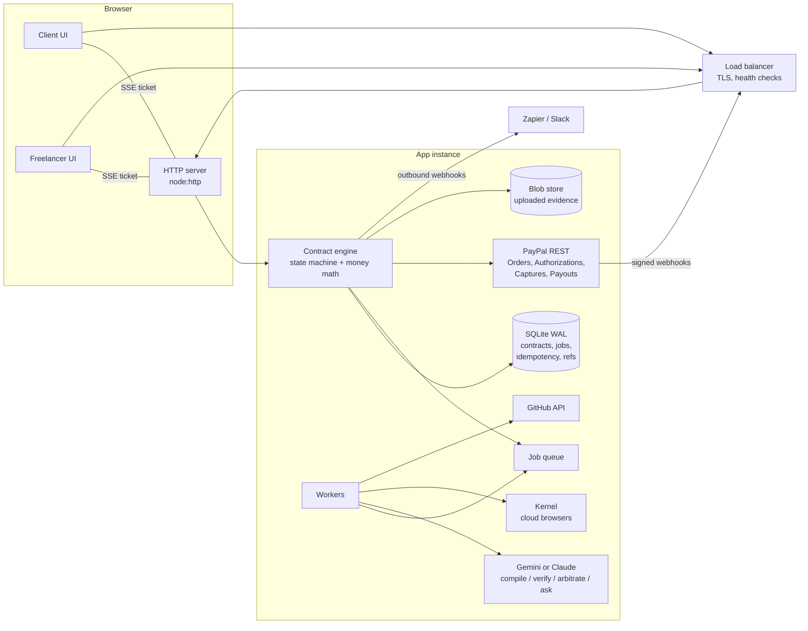

# Covenant: system design

This document describes how Covenant is built today, why, and how it scales. Each section separates what is **implemented** (and tested) from what is **the next step** at higher scale.

## 1. Overview

| Component | File | Responsibility |
| --- | --- | --- |
| HTTP server | `server/index.ts`, `server/http.ts` | Routing, security headers, rate limits, CSRF guard, body limits, idempotency, SSE, static files, health checks, graceful shutdown |
| Access control | `server/access.ts` | Hashed keys, one-time invites, signed stream tickets |
| Contract engine | `server/engine.ts` | The state machine; every money movement goes through it |
| Money math | `server/money.ts` | Integer-cent penalties, splits, fees, rounding (unit tested) |
| PayPal client | `server/paypal.ts` | REST calls with OAuth caching and idempotency keys; a simulator with the same interface for test mode |
| Storage | `server/store.ts` | SQLite with migrations, indexed lookups, transactional writes |
| Jobs | `server/jobs.ts` | Durable queue: atomic claims, retries with backoff, crash recovery |
| Evidence | `server/evidence.ts`, `server/facts.ts`, `server/kernel.ts` | Upload validation, measured file facts, link and GitHub inspection, cloud-browser screenshots |
| AI | `server/ai/*` | Compiler, verifier, arbiter (Claude, forced tool calls) and the rules-engine fallback |
| Analytics | `server/portfolio.ts` | Money dashboard data and the Ask assistant |

## 2. Request lifecycle

1. The load balancer terminates TLS and forwards to an instance. With `TRUST_PROXY=1`, the server reads the client IP and HTTPS status from `X-Forwarded-*`; otherwise it ignores them, so they can't be spoofed.
2. A request ID is assigned (or taken from `X-Request-Id`) and returned in the response and in every log line.
3. Security headers are applied.
   - For pages: `Content-Security-Policy` (scripts only from self, PayPal and the component CDN), `frame-ancestors 'none'`, `X-Frame-Options: DENY`, `Referrer-Policy: no-referrer`, `Permissions-Policy`, and HSTS behind HTTPS.
   - For uploads: a sandboxing CSP and `nosniff`.
4. The rate limit is checked for the route class:

   | Class | Burst | Refill |
   | --- | --- | --- |
   | AI | 12 | 6/min |
   | Evidence | 20 | 6/min |
   | Join | 10 | 2/min |
   | Write | 120 | 60/min |
   | Read | 600 | 300/min |

   Limits are per client IP, and exceeding one returns `429` with `Retry-After`.
5. **CSRF guard.** Every `POST` must be `application/json`, which a cross-site form cannot send without a CORS preflight. The server sends no CORS headers, so the preflight fails.
6. The body limit is enforced per route: 4 KB for joining, 16 KB for compiling, 80 MB for evidence, 256 KB by default.
7. **Idempotency.** A `POST` carrying an `Idempotency-Key` header is looked up per route and caller. A replay returns the stored response with `Idempotent-Replay: true` instead of acting twice. The UI sends stable keys for money actions (`authorize-<orderId>`, `approve-<milestone>-<submission>`, `resolve-<milestone>`).
8. The handler runs. Contract mutations are serialized per contract (`withLock`) and written in a single `BEGIN IMMEDIATE` transaction.
9. A structured access log line is written: method, path with IDs masked, status, latency.

## 3. Identity and access

Covenant has no accounts; each contract is a private space for exactly two parties.

- **Client key.** Created with the contract and returned once. The browser keeps it in local storage. Only its SHA-256 hash is stored.
- **One-time invite.** Created with the contract for the freelancer. The link looks like `/join/<id>#<code>`; the code sits in the URL fragment, which browsers never send to servers, so it never appears in access logs or `Referer` headers. Claiming it issues the freelancer's own key and deletes the invite hash.
  - The client can never act as the freelancer, and the freelancer can never act as the client.
  - The client can reissue the invite (revoking the earlier one) until the freelancer signs.
- **Role enforcement.** Each action checks the caller's role on the server: only the client funds, approves, reclaims or reissues invites; only the freelancer submits evidence; either side can dispute.
- **Live updates.** Live updates use Server-Sent Events, authorized by an HMAC-signed ticket bound to one contract, one role and a 2-minute expiry. Keys are never put in URLs.
- **Constant-time comparison** for every key, invite and ticket check.
- **At rest.** A database leak exposes no usable key or invite (verified by test).

*Next step:* "Log in with PayPal" so both parties can reach all their contracts from any device, and so the payout email is verified by PayPal rather than typed in.

## 4. Money safety

The payment design keeps unearned money from ever moving:

1. **Holds, not charges.** Funding is a PayPal Orders v2 `AUTHORIZE`. Nothing is captured until a milestone is earned.
2. **Captures per milestone.** Only the earned amount (after any late penalty or dispute split) is captured, using `final_capture: true` on the last settlement so PayPal releases the remainder. If nothing was captured, the authorization is voided.
3. **Money math in code, not in the model.** Integer cents throughout. Invariants are tested: `gross = net + penalty + arbiter adjustment`, rounding never loses a cent, and amounts always reconcile to the total.
4. **Who can trigger a payout:**
   - The verifier, only when every condition is met *and* the lowest confidence clears the client's threshold.
   - The client, by approving.
   - The arbiter, by ruling.
   - **Never** the rules-engine fallback alone (proved by the evaluation suite: 0 unsafe payouts).
5. **Prompt-injection resistance.** Evidence is untrusted. Instructions found in files, notes or images are reported, ignored, and force a human decision.
6. **Idempotency.**
   - **Inbound:** the `Idempotency-Key` handling above.
   - **Outbound:** every money-moving PayPal call sends a `PayPal-Request-Id` derived from the contract and milestone, so PayPal itself de-duplicates retries.
7. **Reconciliation.** Payout status arrives through verified webhooks *and* is polled by a background job with backoff until it reaches a final state, so a missed webhook can't leave a payout in limbo.

## 5. Background work

Verification can take several seconds (Claude, plus Kernel opening a site), so it never runs on the request path.

- `POST /evidence` stores the files, marks the milestone `verifying`, enqueues a `verify` job and returns immediately.
- A worker claims the job with a single atomic `UPDATE … RETURNING`, so any number of workers can share the queue without double-processing.
- The job gathers link evidence and runs the verifier **outside** the contract lock, then applies the verdict **inside** the lock, only if the same submission is still the latest and still `verifying`. Stale results are discarded.
- Failures retry with exponential backoff (2 s, 4 s, …). After the last attempt the milestone goes to the client for a manual decision; it is never paid automatically.
- **Crash recovery:** on start-up, jobs left `running` for more than 5 minutes are re-queued.
- **Graceful shutdown:** on `SIGTERM` the server stops accepting connections, closes live-update streams, lets running jobs finish (up to 25 s), then closes the database.

## 6. Storage

- **Implemented: SQLite in WAL mode** via Node's built-in driver (no native dependency).
  - **Tables:** `contracts` (JSON document plus indexed columns for status and PayPal IDs), `paypal_refs` (every PayPal object ID mapped to its contract, for O(1) webhook routing), `jobs`, `idempotency`, `schema_migrations`.
  - **Migrations** are append-only and run in a transaction at start-up.
  - **Upgrades:** older JSON-file data is imported automatically.
- **Blob store:** uploaded evidence lives under `DATA_DIR/uploads/<contract>/`, with names generated by the server, served with a sandboxing CSP, and `Content-Disposition: attachment` for anything that isn't an image, PDF or text.
- **Uploads are validated by content, not name.** The real type comes from the file's first bytes, only a short list of formats is accepted, the limit is 15 MB per file and 12 files per submission, and a JPEG renamed `.png` is detected.

## 7. Scaling out

One instance comfortably serves a hackathon and an early product. SQLite in WAL mode handles thousands of writes per second on one disk, and verification throughput is set by `WORKER_CONCURRENCY` and the AI provider's rate limits. To run several instances behind a load balancer, four pieces of state move out of the process:

| Concern | Today (single instance) | Multi-instance |
| --- | --- | --- |
| Database | SQLite file on a persistent disk | **Postgres**. The schema maps one-to-one (`doc` → `JSONB`); `BEGIN IMMEDIATE` becomes `SELECT … FOR UPDATE` on the contract row; job claims become `FOR UPDATE SKIP LOCKED`. |
| Evidence files | Local disk | **S3-compatible object storage**, served via short-lived signed URLs |
| Live updates | In-process subscriber list | **Redis pub/sub** (or Postgres `LISTEN/NOTIFY`) fanning updates out to whichever instance holds each SSE connection |
| Rate limits | In-process token buckets | **Redis** token buckets (same algorithm, shared counters) |
| Workers | Same process as the web server | **Separate worker service** (e.g. Render Background Worker or Render Workflows) scaled on queue depth |
| Stream-ticket secret | Generated into `DATA_DIR` | `SESSION_SECRET` shared by all instances (already supported) |

**Load balancing:**
- Instances are otherwise stateless, so a round-robin L7 load balancer works and needs no sticky sessions; SSE reconnects get a fresh ticket from any instance.
- `/readyz` checks the database and returns `503` while draining, so the balancer stops routing to an instance before it shuts down. `/healthz` is the liveness check.
- `keepAliveTimeout` (65 s) is set above common balancer idle timeouts (60 s), avoiding the race that produces intermittent 502s.
- Rolling deploys work because of graceful shutdown and because schema migrations are additive.

**Back-of-envelope capacity:**
- **Verification:** a verification takes roughly 3–10 s of AI time, so 4 workers per instance handle on the order of 1,500–4,000 verifications per hour. Scale by adding workers, not web instances.
- **Web tier:** requests are small JSON (evidence uploads aside), so it is bounded by uploads; those should go straight to object storage via signed upload URLs at scale.
- **Cost guard:** AI endpoints are rate limited per IP, and verification only runs when a funded contract receives evidence.

## 8. Threat model

| Threat | Mitigation |
| --- | --- |
| Freelancer tricks the AI into paying | Evidence treated as data; injection detection forces human review; measured facts (file type, dimensions, page count, CSV duplicates, GitHub merge state) outrank claims; evaluation suite tracks unsafe payouts |
| Client pretends to be the freelancer | Separate keys via one-time invite; the creator never receives the freelancer's key |
| Stolen or guessed links | 192-bit random keys, hashed at rest, constant-time comparison; invite codes in URL fragments; join endpoint heavily rate limited |
| Cross-site request forgery | JSON-only POSTs and no CORS; keys sent in a custom header, never cookies |
| Malicious uploads (XSS via SVG, polyglots) | Content sniffing and an allowlist; uploads served with `sandbox` CSP and `nosniff`; non-media files force download |
| Path traversal | Normalized paths confined to the public and upload directories (tested) |
| SSRF via evidence links | Private, loopback and link-local addresses refused; in production, remote pages are opened in Kernel's isolated cloud browsers rather than from the server |
| Double payment from retries | Idempotency keys on our API and PayPal request IDs on every money call |
| Forged PayPal webhooks | Signature verification against PayPal's API before anything is processed |
| Clickjacking | `frame-ancestors 'none'` and `X-Frame-Options: DENY` |
| Secrets in logs | Keys are never logged; invite codes never reach the server's URL logs; paths are logged with IDs masked |
| AI outage, bad key or exhausted free quota | Automatic fallback to the rules engine, which never auto-pays; the status page shows the reason |
| Cost abuse of AI endpoints | Per-IP rate limits on compile, Ask and arbitration |

## 9. Observability

- **Implemented:**
  - JSON logs with timestamp, level, request ID, route, status and latency, plus job outcomes and retries;
  - `/api/status` for a human-readable integration and queue view;
  - `/healthz` and `/readyz` for orchestrators.
- **Next step:** export request latency, queue depth, job failure rate, verification outcomes and PayPal error codes as metrics (OpenTelemetry or Prometheus). Alert on job failures, unsafe-payout regressions in CI, and payouts stuck in a non-final state.

## 10. Testing and CI

| Layer | What runs |
| --- | --- |
| Unit | Money math invariants |
| Engine | Full lifecycle, background verification, one-time invites, keys hashed at rest, role enforcement, upload allowlist, disputes |
| HTTP (real server process) | Security headers, CSRF guard, access control, invite reuse (410), idempotent replay, stream tickets bound to one contract, demo tools off by default, path traversal, rate limiting |
| Evaluation | 24 labelled verifier cases reporting decision accuracy, unsafe payouts and injection detection |
| API collection | Postman collection exercising the lifecycle end to end |
| CI | GitHub Actions on Node 22 and 24: type check, tests, offline evaluation, build |

## 11. Known limitations

- **Funds flow:** sandbox funds are captured by the platform's merchant account and paid out with Payouts. In production, PayPal's multiparty setup should make the freelancer the merchant of record, with platform fees taken at capture.
- **Long contracts:** PayPal authorizations are valid for 29 days (funds are guaranteed for 3). Longer contracts should vault a payment method and authorize each milestone closer to its deadline.
- **Instances:** SQLite means one instance; the path to many is in §7.
